# Практическая работа № 3. Матричные преобразования

**Дисциплина** «Математические основы компьютерной графики»

**Выполнил** Тоц Леонид Александрович, группа ИВТ-2

Интерактивное приложение на Python, Pygame и NumPy объединяет 11 упражнений по двумерной графике. В нём можно сравнить исходные и преобразованные фигуры, ввести свои координаты и пошагово увидеть, как из последовательности поворотов и масштабирований образуется воронка квадратов.

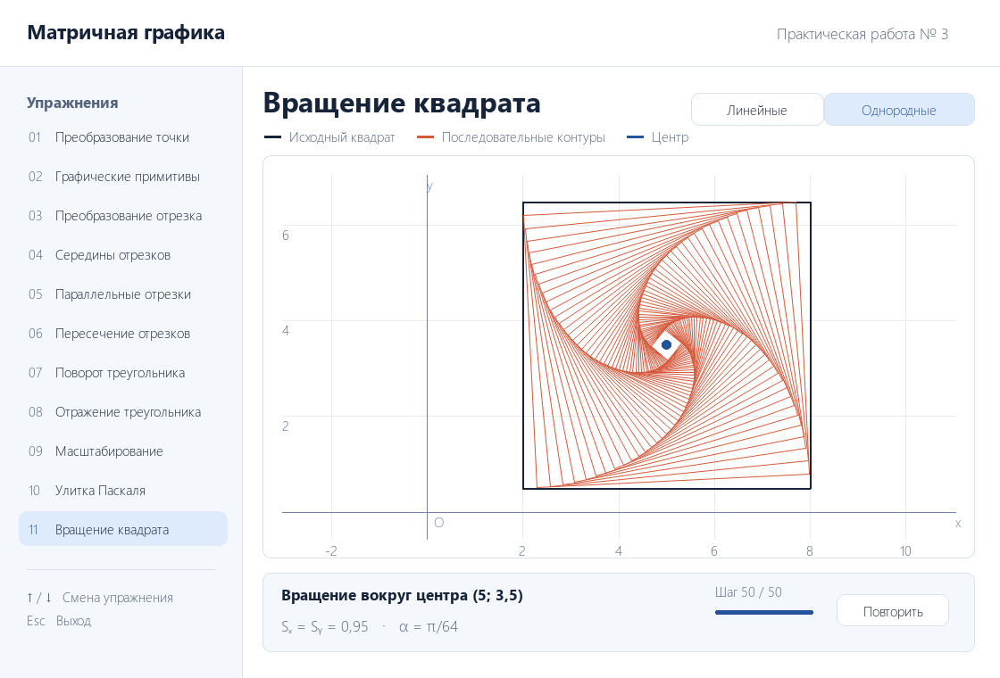

## Запуск

Для запуска на Windows установите Python 3.13. Работа проверена с Python 3.13.2 и Pygame 2.6.1. Из каталога `ЛР3` выполните следующие команды.

```powershell
py -3.13 -m venv .venv
.\.venv\Scripts\python.exe -m pip install -r requirements.txt
.\.venv\Scripts\python.exe -m squares.main
```

По умолчанию открывается упражнение 11. Выберите другое упражнение в списке слева или клавишами ↑ и ↓. В упражнениях 1 и 3 кнопка «Ввести координаты» открывает форму, где числа разделяются пробелами, а дробная часть вводится через точку или запятую. В упражнении 11 **Tab** переключает вид координат, **Пробел** приостанавливает и продолжает анимацию, **R** запускает её заново.

## Как выполнены преобразования

Координаты вершин записаны строками. В упражнениях 1 и 3–9 линейное преобразование вычисляется как `L @ T`, где `L` содержит исходные вершины, а `T` задаёт преобразование. Например, в задаче 1 строка `[3, 2]` даёт `[3·1 + 2·4, 3·3 + 2·1] = [11, 11]`.

Исходная и преобразованная фигуры используют одну систему отсчёта. Переход к пикселям вычисляется по формулам `xpx = x₀ + s·x` и `ypx = y₀ − s·y`, где `s` — число пикселей на единицу координат. Минус во второй формуле учитывает направление экранной оси вниз. В задачах 6 и 7 программа сначала умножает копию исходных координат на 100, выполняет преобразование, а затем одинаково смещает обе фигуры при выводе в окно.

### Перенос примера ManySquares с C

| Файл в примере на C | Реализация на Python |
| --- | --- |
| `graphic_utils.c`, `graphic_utils.h` | Классы `Origin`, `Unit`, `ReferenceFrame`, `Drawer` и функции `get_x`, `get_y`, `get_length` в [squares/graphics.py](squares/graphics.py) |
| `allocation.c`, `matrix_operations.c` | Массивы NumPy, метод `.copy()` и оператор `@`. Память массивов освобождается автоматически. Матрицы поворота, масштабирования и трансляции заданы в [squares/transform.py](squares/transform.py). |
| `matrix_stdio.c` | Ввод координат через форму Pygame, форматирование координат и матриц в [squares/exercises.py](squares/exercises.py) |
| `main.c` | Цикл событий и отрисовка последовательности квадратов в [squares/main.py](squares/main.py). На каждом шаге вершины обновляются матричным произведением из условия. |

### Два режима для квадрата

| Режим | Начальный квадрат | Центр | Шаг | Результат |
| --- | --- | --- | --- | --- |
| Линейные координаты | Вершины (±200, ±200), сторона 400 | (0; 0) | Масштаб 0,9 и поворот на π/32 | 20 шагов, сторона ≈ 48,631, поворот 112,5° |
| Однородные координаты | Вершины (2; 0,5; 1), (8; 0,5; 1), (8; 6,5; 1), (2; 6,5; 1), сторона 6 | (5; 3,5) | Масштаб 0,95 и поворот на π/64 | 50 шагов, сторона ≈ 0,462, поворот 140,625° |

В однородном режиме матрица одного шага вычисляется один раз.

```text
M = TΔ(−xc, −yc) · TS(sx, sy) · TR(α) · TΔ(xc, yc)
L(k + 1) = L(k) · M
```

Первая трансляция совмещает центр квадрата с началом координат. Затем выполняются масштабирование и поворот, после чего последняя трансляция возвращает квадрат на прежнее место. Центр остаётся постоянным, а длина стороны на шаге `k` равна `6 · 0,95^k`. Нулевая итерация показывает исходный контур, поэтому на итоговом кадре 51 квадрат в однородном режиме и 21 в линейном.

Например, на первом шаге вершина `[2; 0,5; 1]` сначала получает координаты `[−3; −3; 1]` относительно центра. После масштабирования они равны `[−2,85; −2,85; 1]`. Поворот на `π/64` и обратный перенос дают приблизительно `[2,2933; 0,5136; 1]`. Для этих аффинных преобразований третья координата остаётся равной 1. При выводе конечной точки с однородными координатами `[X; Y; w]` программа делит `X` и `Y` на `w`.

### Контрольные результаты

| № | Упражнение | Результат |
| --- | --- | --- |
| 1 | Преобразование точки | (3; 2) → (11; 11) |
| 2 | Примитивы | Окружность радиуса 1, два отрезка и текст |
| 3 | Преобразование отрезка | (1; 1) → (5; 4), (4; 2) → (12; 14) |
| 4 | Середины отрезков | M (100; 200) → M′ (700; 400) |
| 5 | Параллельные отрезки | Наклоны (0,5; 0,5) → (1; 1) |
| 6 | Пересекающиеся отрезки | После умножения исходных координат на 100 точка пересечения (80; 20) переходит в (100; 100) |
| 7 | Поворот треугольника | Поворот против часовой стрелки на 90°, например (300; −100) → (100; 300) |
| 8 | Отражение треугольника | Отражение относительно y = x, например (8; 1) → (1; 8) |
| 9 | Масштабирование | Удвоение обеих координат, например (5; 1) → (10; 2) |
| 10 | Улитка Паскаля | Кривая с внутренней петлёй при a = 1, b = 1,2 |

Расчёты можно проверить из каталога `ЛР3` после установки зависимостей.

```powershell
.\.venv\Scripts\python.exe -m unittest discover -s tests -v
```

Проверки сравнивают координаты с контрольными значениями, вычисленными по формулам, и проверяют число шагов, центр, длины сторон и итоговый угол поворота в обоих режимах квадрата.

## Скриншоты упражнений

Все кадры сохранены с поверхности открытого окна Pygame после отрисовки.

| | |
| --- | --- |
| **1. Преобразование точки**<br>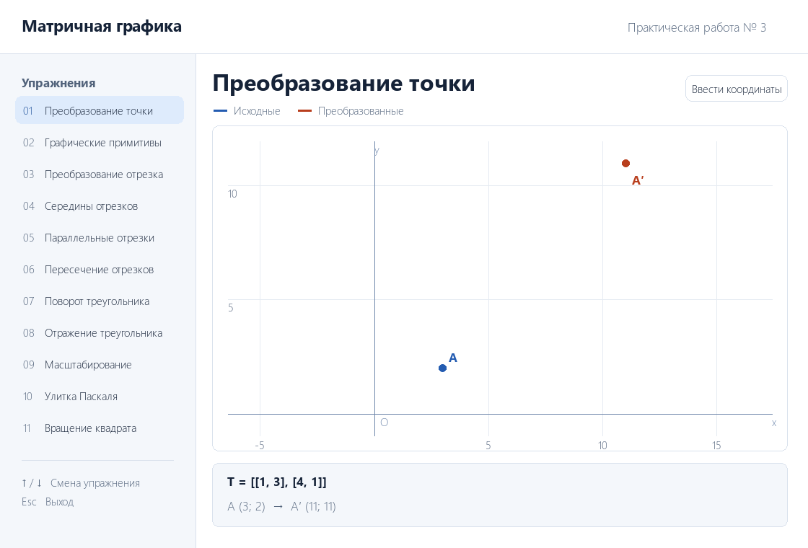 | **2. Графические примитивы**<br>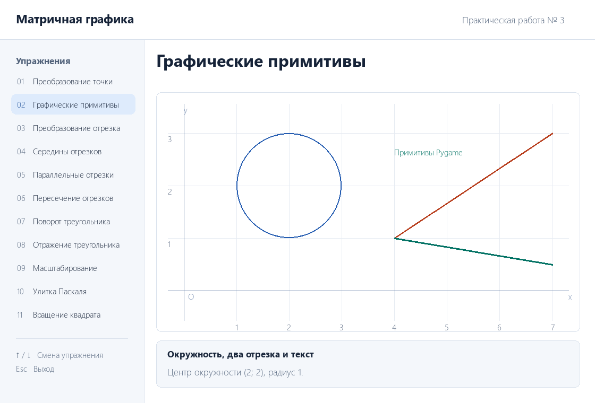 |
| **3. Преобразование отрезка**<br>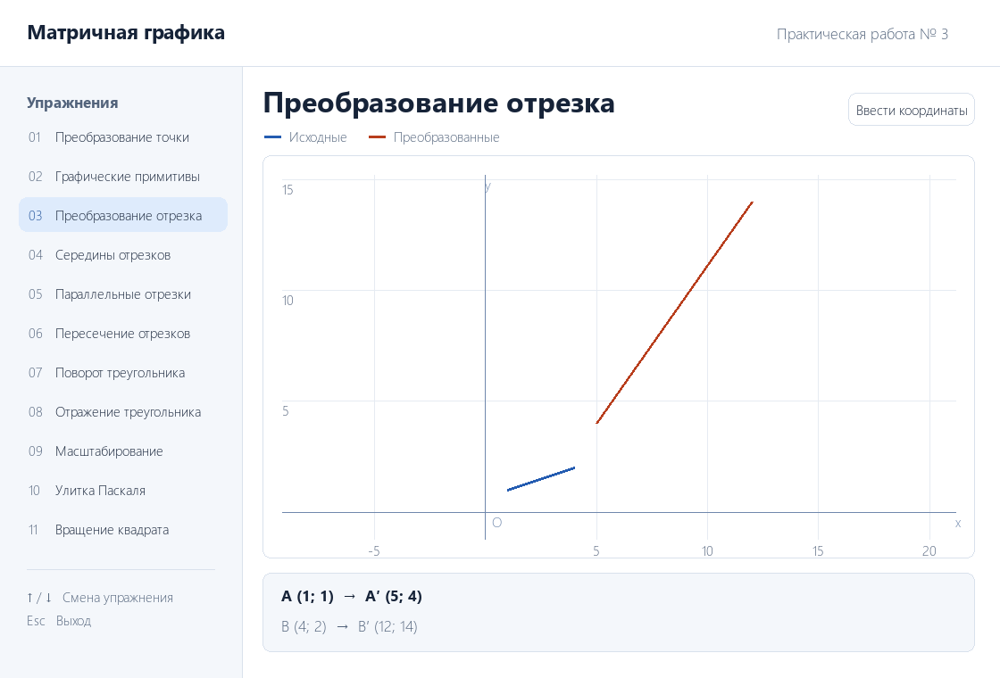 | **4. Середины отрезков**<br>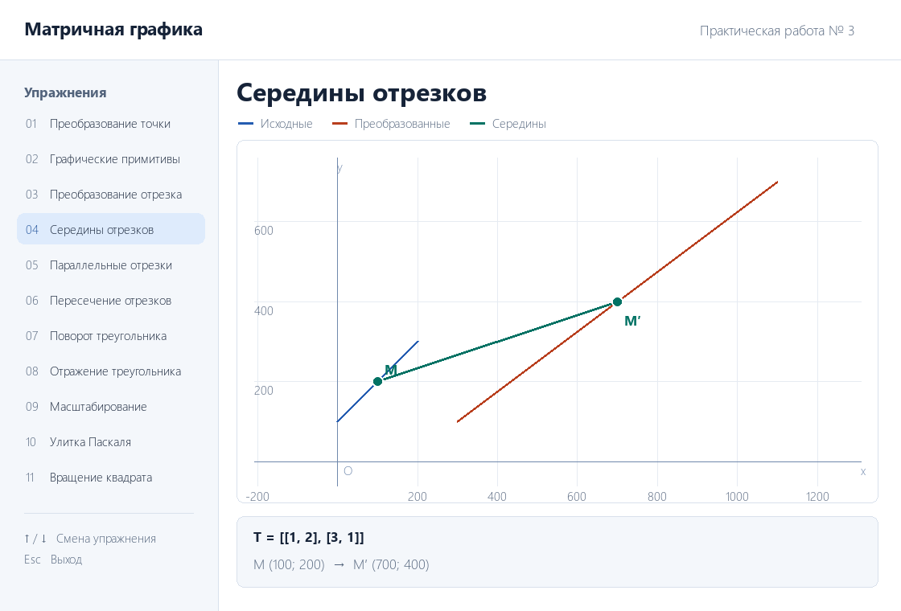 |
| **5. Параллельные отрезки**<br>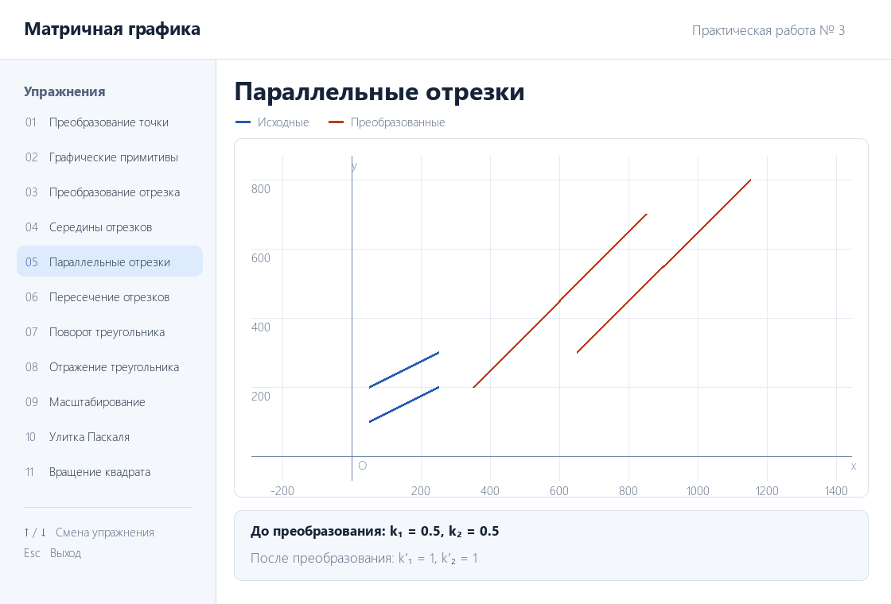 | **6. Пересечение отрезков**<br>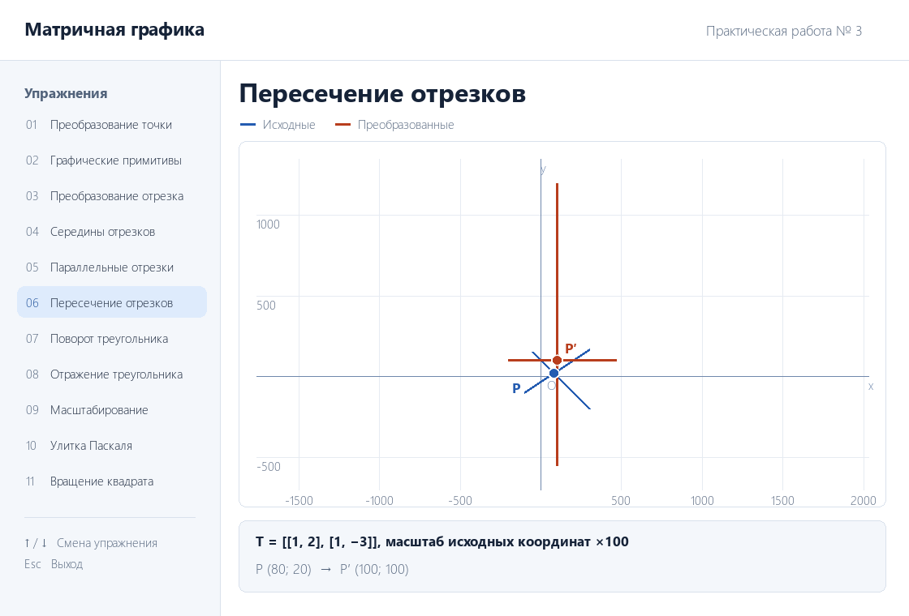 |
| **7. Поворот треугольника**<br>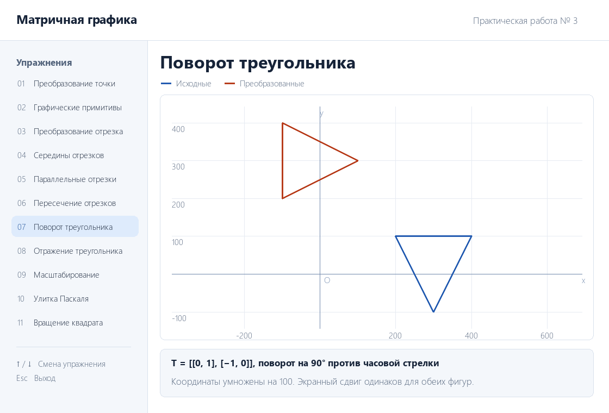 | **8. Отражение треугольника**<br>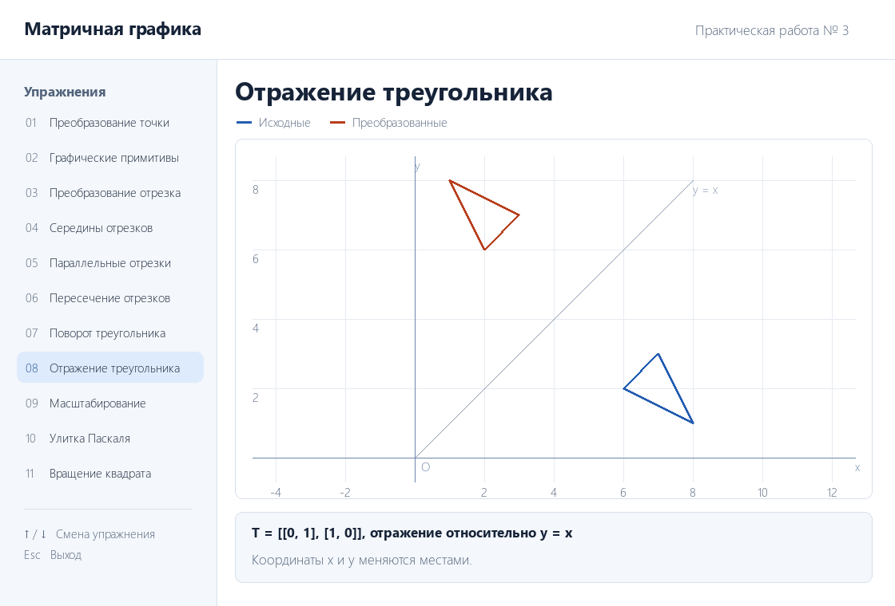 |
| **9. Масштабирование**<br>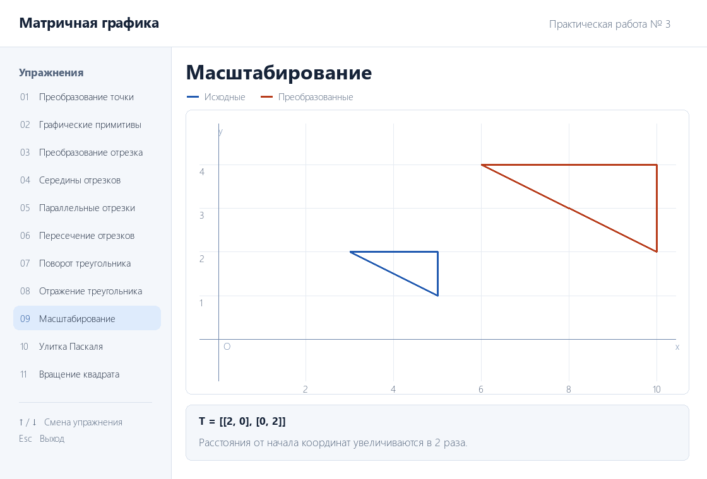 | **10. Улитка Паскаля**<br>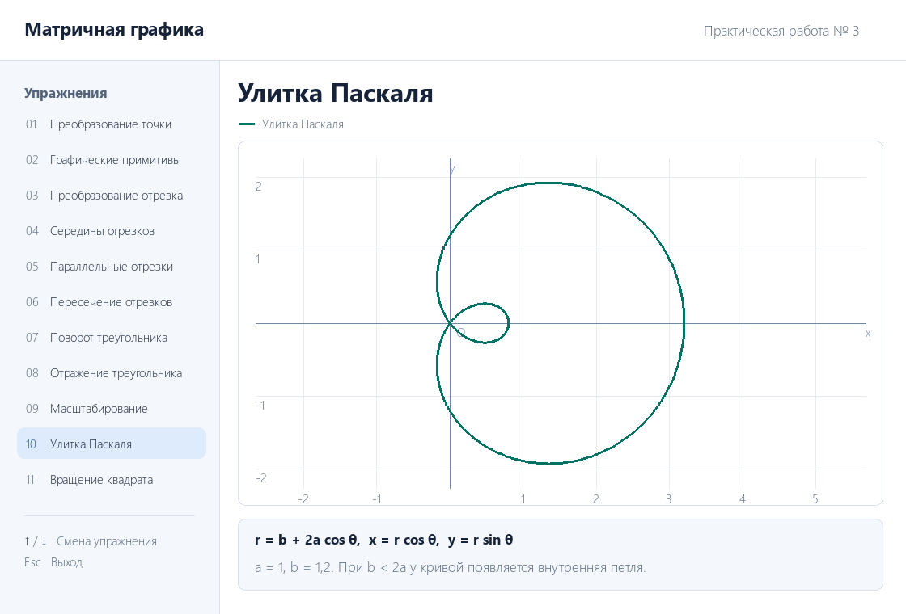 |

**11. Квадрат в линейных координатах после 20 шагов**

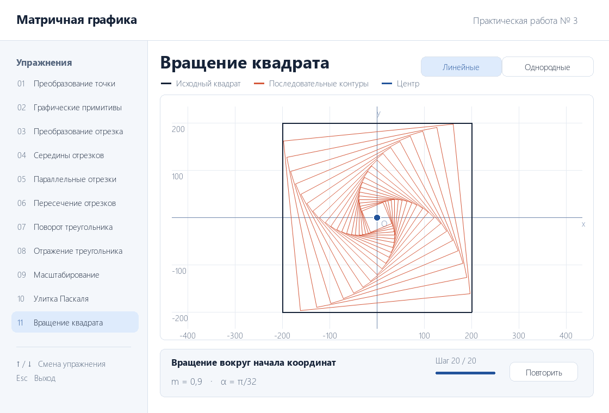

## Материалы

- Условие из курса и архив `ManySquares.zip` с примером на C. Внутренний заголовок PDF «Практическая работа #1» расходится с номером задания в курсе. В отчёте использован номер из курса.
- Конспект «Однородные координаты — Введение».
